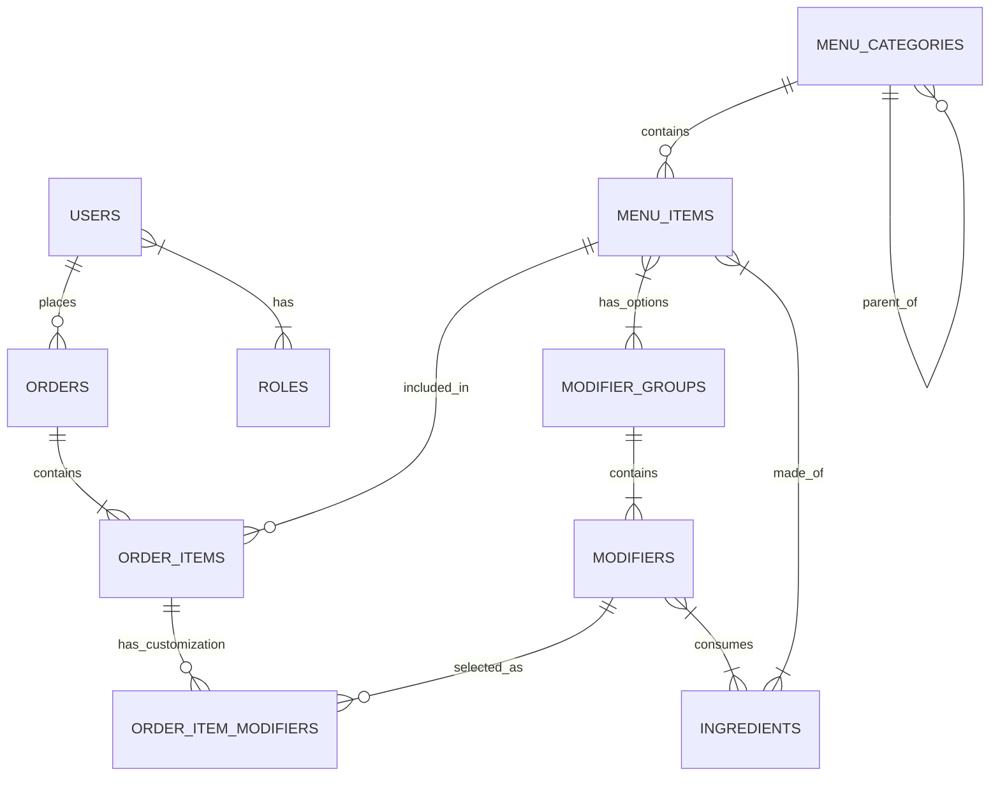

# Restaurant Management System (RMS)

A modern, full-stack web application for managing restaurant operations, including digital menus, online ordering, kitchen management, and staff coordination. Built with Laravel 12, React, and Inertia.js.

## 🌐 Live Deployment

**Production URL:** [https://final-project-diledfranc-production.up.railway.app](https://final-project-diledfranc-production.up.railway.app)

*Note: The application is hosted on Railway using Docker containers.*

## 🚀 Features

-   **Role-Based Access Control (RBAC)**: Secure access for Admins, Managers, Staff, and Customers.
-   **Digital Menu**: Interactive menu with categories, modifiers, and search functionality.
-   **Shopping Cart & Checkout**: Seamless ordering experience for customers.
-   **Real-Time Updates**: Live order tracking and status updates using Laravel Reverb (WebSockets).
-   **Kitchen Display System**: Real-time view of incoming orders for kitchen staff.
-   **Admin Dashboard**: Comprehensive analytics and management tools.
-   **Authentication**: Secure login and registration via Laravel Fortify.
-   **Email Notifications**: Transactional emails powered by Resend.

## 🛠️ Tech Stack

### Backend
-   **Framework**: [Laravel 12](https://laravel.com) (PHP 8.2+)
-   **Database**: MySQL
-   **Real-Time**: Laravel Reverb (WebSocket Server)
-   **Authentication**: Laravel Fortify & Sanctum
-   **Mail**: Resend SDK

### Frontend
-   **Framework**: [React](https://react.dev)
-   **Glue**: [Inertia.js](https://inertiajs.com) (Monolith structure)
-   **Styling**: [Tailwind CSS v4](https://tailwindcss.com)
-   **Components**: [Shadcn UI](https://ui.shadcn.com) (Radix UI + Lucide Icons)
-   **State Management**: React Hooks

### DevOps & Deployment
-   **Platform**: [Railway](https://railway.app)
-   **Containerization**: Docker (Custom `Dockerfile`)
-   **CI/CD**: GitHub Actions (optional/manual push)

## 🗄️ Database Schema (ERD)

The application uses a normalized relational database schema.



## 👥 Roles & Permissions

| Role | Description | Key Permissions |
| :--- | :--- | :--- |
| **Admin** | System Administrator | Full access to all modules, User Management, Settings, Reports. |
| **Manager** | Restaurant Manager | Menu Management, Inventory, Staff Management, Sales Reports. |
| **Staff** | Waitstaff / Cashier | POS System, Order Management, Table Management. |
| **Kitchen** | Kitchen Staff | Kitchen Display System (KDS), Order Status Updates. |
| **Customer** | End User | Browse Menu, Place Orders, View Order History. |

## 🔌 API Endpoints & Routes

Since this is an **Inertia.js** application, it uses standard web routes that return JSON props to React components.

| Method | Endpoint | Description |
| :--- | :--- | :--- |
| **Auth** | | |
| `POST` | `/login` | Authenticate user |
| `POST` | `/register` | Register new customer |
| `POST` | `/logout` | End session |
| **Menu** | | |
| `GET` | `/api/menu` | Fetch paginated menu items |
| `GET` | `/api/categories` | Fetch menu categories |
| **Orders** | | |
| `POST` | `/checkout` | Submit a new order |
| `GET` | `/customer/orders` | View order history |
| **Admin** | | |
| `GET` | `/dashboard` | Admin analytics dashboard |
| `GET` | `/orders` | Manage all orders |
| `GET` | `/inventory` | Manage ingredients & stock |

## ⚠️ Known Limitations

### Email Sending (Resend)
The application uses the **Resend** service for transactional emails.
*   **Limitation:** Currently running on the **Free Tier (Sandbox Mode)**.
*   **Impact:** Emails can **only** be sent to the verified administrator email address (`adelaidefrancis7@gmail.com`). Registration with other email addresses will fail with an API error unless the domain is verified.

## 📋 Prerequisites

Ensure you have the following installed locally:
-   PHP >= 8.2
-   Composer
-   Node.js >= 20
-   MySQL

## ⚙️ Installation

1.  **Clone the repository**
    ```bash
    git clone https://github.com/Asia-Pacific-International-university/final-project-diledfranc.git
    cd final-project-diledfranc
    ```

2.  **Install Backend Dependencies**
    ```bash
    cd restaurant-management-system
    composer install
    ```

3.  **Install Frontend Dependencies**
    ```bash
    npm install
    ```

4.  **Environment Setup**
    Copy the example environment file and configure your database credentials.
    ```bash
    cp .env.example .env
    php artisan key:generate
    ```

5.  **Database Setup**
    Create a MySQL database and update `.env` with your credentials (`DB_DATABASE`, `DB_USERNAME`, etc.). Then run migrations and seeders:
    ```bash
    php artisan migrate --seed
    ```
    *Note: The seeder creates default users (Admin, Manager, Staff) and demo menu items.*

6.  **Build Assets**
    ```bash
    npm run build
    ```

## 🚀 Running Locally

To run the application locally, you need to start three processes:

1.  **Laravel Server**
    ```bash
    php artisan serve
    ```

2.  **Vite Development Server** (for hot module replacement)
    ```bash
    npm run dev
    ```

3.  **Reverb WebSocket Server** (for real-time features)
    ```bash
    php artisan reverb:start
    ```

Visit `http://localhost:8000` in your browser.

## ☁️ Deployment (Railway)

This project is configured for deployment on [Railway](https://railway.app).

### Configuration Files
-   `Dockerfile`: Defines the production image (PHP 8.2 CLI, Node build, Redis ext).
-   `railway.toml`: Forces Railway to use the Dockerfile builder.
-   `AppServiceProvider.php`: Forces HTTPS scheme in production.

### Environment Variables
Ensure the following variables are set in your Railway project:

| Variable | Description |
| :--- | :--- |
| `APP_ENV` | `production` |
| `APP_KEY` | Generated application key |
| `APP_URL` | `https://<your-railway-app>.up.railway.app` |
| `DB_CONNECTION` | `mysql` |
| `DATABASE_URL` | (Provided by Railway MySQL service) |
| `REDIS_URL` | (Provided by Railway Redis service) |
| `RESEND_API_KEY` | Your Resend API Key for emails |
| `REVERB_APP_ID` | Random string |
| `REVERB_APP_KEY` | Random string |
| `REVERB_APP_SECRET` | Random string |
| `REVERB_HOST` | `0.0.0.0` |
| `REVERB_PORT` | `8080` (or your configured port) |
| `REVERB_SCHEME` | `https` |
| `REQUIRE_EMAIL_VERIFICATION` | `true` (Set to `false` to disable verification) |

### Deployment Steps
1.  Connect your GitHub repo to Railway.
2.  Add a MySQL service.
3.  Add a Redis service.
4.  Configure the variables above.
5.  Railway will automatically build using the `Dockerfile`.
6.  **First Run**: The `Dockerfile` automatically runs migrations and seeds the database if it's empty.

## 🧪 Testing

Run the test suite using Pest PHP:

```bash
php artisan test
```

## 📄 License

This project is open-sourced software licensed under the [MIT license](https://opensource.org/licenses/MIT).

